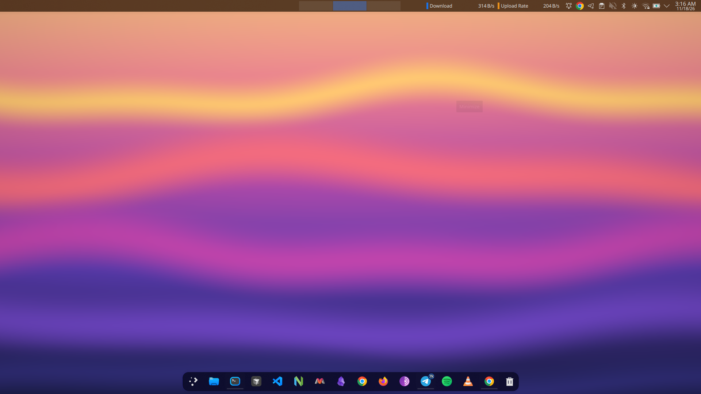

<h1 align="center">spectre-kde</h1>

<p align="center">
  <strong>A clean, reversible, reproducible KDE Plasma 6 setup with a polished macOS-inspired workflow — 100% native to KDE.</strong>
</p>

<p align="center">
  <a href="LICENSE"></a>
  
  
  
</p>

<p align="center">
  <a href="https://github.com/bigwalkdoe/spectre-kde/actions/workflows/lint.yml"></a>
  <a href="https://github.com/bigwalkdoe/spectre-kde/actions/workflows/authorship-check.yml"></a>
</p>

<p align="center">
  <sub><code>top menu bar · floating dock · clean desktop · reversible config · native Plasma scripting</code></sub>
</p>

---

```text
┌──────────────────────────────────────────────────────────────────────────────┐
│  Global Menu      ▍▍▍ Pager        ↓↑  Wi-Fi  🔊  🔋  19:32                │
├──────────────────────────────────────────────────────────────────────────────┤
│                                                                              │
│                                CLEAN DESKTOP                                 │
│                         (no icons, native containment)                       │
│                                                                              │
│                    ╭────────────────────────────────────╮                    │
│                    │     ●  ●  ●  ●  ●  ●  ●   🗑  │                    │
│                    ╰────────────────────────────────────╯                    │
│                         centered, fit-to-content dock                        │
└──────────────────────────────────────────────────────────────────────────────┘
```

## Contents

- [What spectre-kde is](#what-spectre-kde-is)
- [Features](#features)
- [Screenshots](#screenshots)
- [Quick start](#quick-start)
- [Usage](#usage)
- [Component managers](#component-managers)
- [Safety & reversibility](#safety--reversibility)
- [Configuration & profiles](#configuration--profiles)
- [Testing](#testing)
- [Documentation](#documentation)
- [License](#license)

## What spectre-kde is

**spectre-kde** configures Fedora KDE (and other KDE Plasma 6 desktops) into a minimal, premium, macOS-inspired workspace while staying fully native to KDE. It favors Plasma’s own APIs, scripting, and config systems over third-party docks, hacks, or fragile shell replacements.

The project is built around a simple contract:
- **Native:** use official KDE/Plasma tools and scripting where possible
- **Reversible:** take timestamped backups and support rollback/reset workflows
- **Reproducible:** declarative-ish configs, profiles, and idempotent apply steps
- **Safe by default:** preflight/doctor checks, guarded operations, and testable scripts

> [!NOTE]
> Target environment is **KDE Plasma 6.x** on Linux. Scripts are designed to be run from a user session with access to the appropriate KDE tooling.

## Features

| Area | What it provides |
|---|---|
| **Layout** | Top menu bar (global menu, pager, network speed, tray, clock) and a centered, fit-to-content floating dock with pinned launchers |
| **Desktop** | Clean desktop containment (no desktop icons), wallpaper management, polished defaults |
| **Theming** | Orchis look-and-feel (light/dark), color schemes, icons, cursor, GTK 3/4, splash, optional SDDM theme assets |
| **Top bar widgets** | Configurable app menu, pager, network speed indicator (modes: dual/download/upload, labels optional), system tray, and clock |
| **System integration** | Autostart, notifications, night light, power profiles, fonts, KWin rules, keyboard shortcuts/profile helpers |
| **Operations** | Interactive menu, doctor/health/system-check, apply/quick-update, backup/rollback/reset/sync/status/detect flows |
| **Profiles** | Profile export/import and presets (e.g. `profiles/dev`) for repeatable setups |
| **Testing** | `scripts/run-tests.sh` runs all `scripts/test-*.sh` suites with stubbed KDE tools in temp dirs (no live Plasma session required) |

## Screenshots

A selection of captured states from `screenshots/` (see [`screenshots/README.md`](screenshots/README.md) for more):

| | |
|---|---|
|  |  |
|  |  |

## Quick start

```bash
# Clone and enter
git clone https://github.com/bigwalkdoe/spectre-kde.git
cd spectre-kde

# Optional: check dependencies and environment first
./doctor.sh

# Interactive setup (recommended)
./menu.sh

# Or apply directly
./apply.sh --light   # Light theme
./apply.sh --dark    # Dark theme
```

Helpful first-run tools:
- `./welcome.sh` — guided tour / onboarding
- `./doctor.sh` — diagnose missing dependencies and common issues
- `./system-check.sh` — run combined checks (doctor + preflight + verify)

## Usage

### Core commands

| Command | Purpose |
|---|---|
| `./apply.sh [--light\|--dark]` | Apply the full spectre-kde configuration |
| `./quick-update.sh` | Reapply layout/dock/top-bar/tray-related updates quickly |
| `./menu.sh` | Interactive menu for common operations and component management |
| `./status.sh` | Show current state/status information |
| `./verify.sh` | Verify applied configuration and expected state |
| `./backup.sh` | Create a backup snapshot |
| `./rollback.sh` | Roll back to a previous backup |
| `./reset.sh` | Reset/restore options |
| `./sync.sh` | Sync current config/state back into the repo where supported |
| `./detect.sh` | Detect environment/session details |
| `./update.sh` | Update workflow helper |
| `./doctor.sh` | Diagnose dependencies and environment issues |
| `./health.sh` | Health dashboard |
| `./system-check.sh` | Combined checks |
| `./fix-issues.sh` | Attempt automated fixes for common issues |
| `./commands.sh` | Quick command reference |
| `./install-deps.sh` | Install dependencies (review before running) |

### Typical workflow

```bash
# 1) Inspect and validate
./doctor.sh
./detect.sh

# 2) Apply
./apply.sh --light

# 3) Iterate quickly on layout/dock/top-bar changes
./quick-update.sh

# 4) Verify and inspect
./verify.sh
./status.sh
```

## Component managers

Most components can be managed independently via `scripts/manage-*.sh`:

| Manager | Purpose |
|---|---|
| `scripts/manage-dock.sh` | Dock launchers and dock config (view/config path in `scripts/dock-config`, `set <key> <val>`, fit/center/behavior tuning) |
| `scripts/manage-topbar.sh` | Top bar widgets/layout/config (app menu, pager, netspeed visibility/mode/labels, tray, clock, status/reset) |
| `scripts/manage-tray.sh` | System tray pinned items |
| `scripts/manage-wallpaper.sh` | Wallpaper settings (including per-monitor support) |
| `scripts/manage-autostart.sh` | Autostart applications |
| `scripts/manage-notifications.sh` | Notification settings |
| `scripts/manage-nightlight.sh` | Night Color (blue light filter) |
| `scripts/manage-kwin-rules.sh` | KWin window rules |
| `scripts/manage-shortcuts.sh` | Keyboard shortcuts / declared shortcuts helpers |
| `scripts/manage-fonts.sh` | Fonts, exclusions, font cache |
| `scripts/manage-icons.sh` | Icon theme |
| `scripts/manage-cursor.sh` | Cursor theme and size |
| `scripts/manage-gtk.sh` | GTK 3/4 theme integration |
| `scripts/manage-splash.sh` | Plasma splash screen theme |
| `scripts/manage-sddm.sh` | SDDM login screen status/install/reinstall helpers |
| `scripts/manage-power.sh` | Power profiles (performance/balanced/power saver) |
| `scripts/manage-profile.sh` | Profile operations (`list`, `show/info`, `import`, `export`, `apply`); profile names are validated |
| `scripts/enforce-dock-view-settings.sh` | Normalize live dock panel view settings (length/alignment) across existing Plasma screen subgroups |
| `scripts/clean-backups.sh` | Prune old timestamped backups (keep newest N) |

> [!TIP]
> Many managers modify config files used by `apply.sh` / `quick-update.sh`. After changes, re-run the appropriate apply command to see results in a live Plasma session. `./menu.sh` provides integrated dock/top-bar/profile workflows (including netspeed mode/labels and dock view enforcement).

## Safety & reversibility

- **Timestamped backups:** apply/update flows create backups so changes can be rolled back
- **Rollback/reset tooling:** `./rollback.sh`, `./reset.sh`, and backup cleanup utilities are included
- **Preflight/verification:** scripts and checks help catch missing dependencies or inconsistent state
- **Native mechanisms:** prefers Plasma scripting and KDE config tools over destructive or opaque hacks

When running on a live Plasma session, some changes require `plasmashell` restarts/reloads or layout reapplication; `apply.sh` / `quick-update.sh` handle the expected flows for this project.

## Configuration & profiles

- **Configs:** `config/applied-*.conf` snapshots capture applied state for KDE/GTK/fonts/power/notifications and related components
- **Top bar config:** `scripts/topbar-config` controls visibility and netspeed behavior (`TOPBAR_SHOW_*`, `TOPBAR_NETSPEED_MODE=dual|download|upload`, `TOPBAR_NETSPEED_LABELS=true|false`, `TOPBAR_HEIGHT_MULTIPLIER`)
- **Dock config:** `scripts/dock-config` stores dock behavior (position, floating/centered/fit-to-content, icon/label preferences); manage via `scripts/manage-dock.sh config|set` and persist/normalize view settings with `scripts/set-dock-view-settings.sh` / `scripts/enforce-dock-view-settings.sh`
- **Profiles:** `profiles/` contains reusable presets (e.g. `profiles/dev/`) for dock/top bar/tray/autostart and related settings
- **Profile tools:** `scripts/manage-profile.sh` (`list`, `show/info`, `import`, `export`, `apply`) plus `scripts/export-profile.sh` / `scripts/import-profile.sh` support profile workflows; profile names are validated (letters, digits, dot, underscore, hyphen)
- **Assets:** wallpapers, SDDM theme assets, and desktop entries live under `assets/`

## Testing

```bash
./scripts/run-tests.sh
```

- Runs every `scripts/test-*.sh` suite and prints a summary
- Test suites stub external KDE tools they need and use temporary directories
- No live Plasma session is required
- CI runs the same entry point, so newly added `test-*.sh` files are picked up automatically

## Development Architecture

### Shared Library

`scripts/lib/plasma.sh` provides common utilities for Plasma 6 interaction:

- **Panel detection** — dock panel via `icontasks`, panel IDs from layout output
- **Config helpers** — safe `kwriteconfig6`/`kreadconfig6` wrappers, PlasmaViews panel/group operations
- **Plasmashell management** — restart, session detection
- **Logging** — colorized helpers (`log_ok`, `log_warn`, `log_err`, `log_info`)

Scripts using the library: `apply.sh`, `quick-update.sh`, `scripts/enforce-dock-view-settings.sh`, `scripts/set-dock-view-settings.sh`.

See [`scripts/lib/README.md`](scripts/lib/README.md) for full API documentation.

### Script Organization

| Category | Pattern |
|----------|---------|
| Core workflows | `apply.sh`, `quick-update.sh`, `verify.sh`, `menu.sh` |
| Component managers | `scripts/manage-*.sh` |
| Profile/backup | `scripts/import-profile.sh`, `scripts/export-profile.sh`, `backup.sh`, `rollback.sh` |
| Shared library | `scripts/lib/plasma.sh` |
| Test suites | `scripts/test-*.sh` (auto-discovered by `run-tests.sh`) |

### Adding New Tests

Create `scripts/test-<name>.sh` following existing patterns:
- Use `set -u`, temp dirs (`mktemp -d`), and `trap` cleanup
- Stub external KDE tools (`kreadconfig6`, `kwriteconfig6`, `qdbus6`, etc.) in `WORK/bin/`
- Source the library with `PATH="$WORK/bin:$PATH" source "$ROOT/scripts/lib/plasma.sh"`
- Print `ok`/`FAIL` lines; exit 0 on all pass, 1 on any failure

The test runner (`scripts/run-tests.sh`) auto-discovers all `test-*.sh` files.

## Documentation

| Document | Purpose |
|---|---|
| [`TROUBLESHOOTING.md`](TROUBLESHOOTING.md) | Common issues, diagnostics, and recovery |
| [`CONTRIBUTING.md`](CONTRIBUTING.md) | Development workflow and contribution guidelines |
| [`SECURITY.md`](SECURITY.md) | Security policy and reporting guidance |
| [`screenshots/README.md`](screenshots/README.md) | Screenshot catalog and context |
| [`AGENTS.md`](AGENTS.md) | Repository guidance for AI/code agents |
| [`scripts/lib/README.md`](scripts/lib/README.md) | Shared Plasma utilities library API |
| [`CHANGELOG.md`](CHANGELOG.md) | Version history and release notes |

## License

MIT — see [`LICENSE`](LICENSE).

Scripts, documentation, and vendored wallpaper assets in this repository are covered by the project license. Upstream themes/assets (e.g. Orchis, FairyWren, Bibata, SDDM theme components) remain subject to their respective upstream licenses.

<p align="center">
  <sub><code>spectre-kde</code> · native Plasma 6 · reversible by design · <code>./doctor.sh</code> before you dive deep</sub>
</p>
